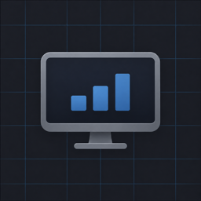
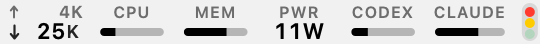
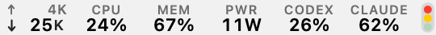
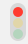
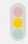
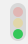
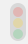
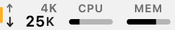
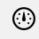

<div align="center">



# MacSignal

**Your Mac and your coding agents, at a glance from the menu bar.**

Network, CPU, memory and power, plus which of your Claude Code, Codex and iCode sessions is
waiting for you, and how much of your AI subscription is left.


English | [简体中文](README.zh.md)

</div>

## Why MacSignal

- **Know when an agent needs you.** A three-lamp traffic light in the menu bar turns red the
  moment a session waits for your approval, so you can stop checking terminal tabs.
- **See your AI limits before you hit them.** Claude Code and Codex usage sits next to CPU and
  memory, with reset times one click away.
- **A system monitor that stays small.** Network, CPU, memory and power in a compact item that
  follows the light or dark menu bar. Hover for details, click for the top processes.
- **Lightweight and local.** Native Swift and AppKit, no third-party dependencies, no Dock icon,
  no admin rights, no background service. Nothing leaves your Mac except the Claude Code usage
  requests to Anthropic described [below](#ai-usage).
- **English and Simplified Chinese**, following your system languages.

## Supported agents

| Agent | Session status | Subscription usage |
| --- | :---: | :---: |
| [Claude Code](https://www.anthropic.com/claude-code) | ✓ | ✓ |
| [Codex](https://openai.com/codex) | ✓ | ✓ |
| [iCode](https://github.com/openJiuwen-ai/iCode) | ✓ | — |

MacSignal connects to each agent through the agent's own hooks: no wrappers, no patched
binaries. See [Connecting agents](#connecting-agents).

> **New to iCode?** [iCode](https://github.com/openJiuwen-ai/iCode) is an open-source coding
> agent for the terminal. Agents are configuration, not code; model profiles from different
> providers sit side by side and switch mid-conversation; every change the agent made is a diff
> you can review or roll back turn by turn; and a trajectory view shows where the time and
> tokens went. Try it with `uv tool install iCode-TUI`, then run `icode`.

## What the menu bar shows

Pick the modules under **Settings › Display**. The images below follow your GitHub theme;
MacSignal itself follows the menu bar.

**Bars or numbers.** CPU, memory and AI usage are bars by default; **Show Numbers** turns them into
percentages.

<table>
  <tr><th>Bars (default)</th></tr>
  <tr><td><picture><source media="(prefers-color-scheme: dark)" srcset="docs/menu-bar-dark.png"></picture></td></tr>
  <tr><th>Show Numbers</th></tr>
  <tr><td><picture><source media="(prefers-color-scheme: dark)" srcset="docs/numbers-dark.png"></picture></td></tr>
</table>

**The traffic light.** Each lamp counts the sessions of every connected agent, and several lamps
can be lit at once.

<table>
  <tr>
    <td align="center"><picture><source media="(prefers-color-scheme: dark)" srcset="docs/light-waiting-dark.png"></picture></td>
    <td align="center"><picture><source media="(prefers-color-scheme: dark)" srcset="docs/light-working-dark.png"></picture></td>
    <td align="center"><picture><source media="(prefers-color-scheme: dark)" srcset="docs/light-done-dark.png"></picture></td>
    <td align="center"><picture><source media="(prefers-color-scheme: dark)" srcset="docs/light-idle-dark.png"></picture></td>
  </tr>
  <tr>
    <td align="center"><b>Red</b><br>waiting for your approval</td>
    <td align="center"><b>Yellow</b><br>working</td>
    <td align="center"><b>Green</b><br>finished, not looked at yet</td>
    <td align="center"><b>All off</b><br>nothing needs you</td>
  </tr>
</table>

**Prevent Sleep** adds an orange bar on the left, so you can tell at a glance that the Mac will
stay awake. With every module turned off, the menu bar shows the app icon instead.

<table>
  <tr><th>Prevent Sleep on</th><th>No modules</th></tr>
  <tr>
    <td><picture><source media="(prefers-color-scheme: dark)" srcset="docs/sleep-dark.png"></picture></td>
    <td align="center"><picture><source media="(prefers-color-scheme: dark)" srcset="docs/icon-only-dark.png"></picture></td>
  </tr>
</table>

## Install

You need Xcode or the Command Line Tools (Swift 5.9 or later).

```sh
git clone https://github.com/Miaoranmmm/MacSignal.git && cd MacSignal
./scripts/install.sh
```

`install.sh` builds the app, quits any running MacSignal, installs it to
`/Applications/MacSignal.app` and starts it. To start it at login, add it in **System Settings ›
General › Login Items**.

<details>
<summary><b>Signing</b>: keep Accessibility permission across rebuilds</summary>

macOS remembers Accessibility permission by the app's signature. With the default ad hoc
signature every rebuild looks like a new app and you have to grant it again. Sign with a
certificate from your keychain instead, an Apple Development certificate or a self-signed code
signing certificate. `install.sh` uses one named `MacSignal Local Signing` when your keychain has
it, or the one you name:

```sh
MACSIGNAL_SIGN_IDENTITY="Apple Development: Your Name (TEAMID)" ./scripts/install.sh
```

To build without installing, run `./scripts/build.sh` (output in `build/MacSignal.app`). Do not run
the app from `build/` for daily use: the agent hooks remember the path the app was started from,
and `build/` is replaced on every build.

</details>

## Connecting agents

1. Open **Settings › Agents** and tick Claude Code, Codex or iCode. Agents not found on this Mac
   are grayed out.
2. Restart the agent.
3. **Codex only:** Codex runs a new hook only after you approve it. Open Codex and approve the
   MacSignal hooks when it asks. Until then Codex sessions do not appear and Codex usage is not
   read. Codex asks again whenever the hook command changes, for example after you move
   `MacSignal.app`.

MacSignal adds its hooks to these files:

| Agent | File changed |
| --- | --- |
| Claude Code | `~/.claude/settings.json` |
| Codex | `~/.codex/hooks.json`, and `[features] hooks = true` in `~/.codex/config.toml` |
| iCode | `~/.chrys/hooks/hooks.yaml` |

Before the first change, the original file is backed up as `<file>.bak-macsignal`. Unticking an
agent removes only the hooks MacSignal added.

Each hook runs `MacSignal hook <state> <agent>`, which sends the session state to the running
MacSignal over `~/.macsignal.sock`. When MacSignal is not running the hook does nothing, so the
agent never sees an error.

### The session list

Click the menu bar item to see the sessions. Each row starts with the agent's icon. Sessions that
need attention (waiting for you, working, finished and unread) are always listed; read ones fill
the list up to five rows, and sessions quiet for more than 30 minutes go under **N earlier
sessions**. Click a row to open the session and mark it read, or use **Mark All as Read**.

## AI usage

Tick **AI Usage** under **Settings › Display**. It appears once Claude Code or Codex is connected.
Usage exists only for subscription accounts (for example Claude Pro / Max, or a ChatGPT plan
with Codex). The cell shows the window you have used the most of; the menu lists every window
with its reset time. When every window has passed its reset time the cell shows `—` until the
next use.

- **Codex**: read from Codex's own session logs whenever a Codex hook runs, so it needs the hooks
  approved (see [Connecting agents](#connecting-agents)).
- **Claude Code**: read every 5 minutes from the same service Claude Code's `/usage` command
  uses. MacSignal reads Claude Code's login from the keychain item `Claude Code-credentials` with
  the `security` command, the same way Claude Code does, so no keychain dialog appears. Ticking
  AI Usage with Claude Code connected is your permission for this. The login is sent only to
  Anthropic's usage service and is never logged or changed.
  - If you only use the Claude desktop app, that login expires after a few hours. MacSignal then
    asks Claude Code to renew it itself: first with `claude mcp list`, which uses no quota, and
    if that does not help, with a one-word request to the smallest model (about 650 tokens, at
    most once every 8 hours). Both run with your system proxy.
  - MacSignal also adds a silent `statusLine` command to `~/.claude/settings.json` so usage
    updates while you work in the terminal. If you already have your own status line it is left
    alone, and Settings shows *Claude Code has its own status line, not counted*.

## Settings

Everything is in the menu under **Settings**. All choices are remembered, except **Prevent
Sleep**, which is off again after MacSignal restarts.

| Setting | What it does | Default |
| --- | --- | --- |
| **Prevent Sleep** (main menu) | Keeps the Mac from sleeping when idle, on battery or power. The display can still turn off. | Off |
| **Agents** › Claude Code / Codex / iCode | Adds or removes MacSignal's hooks in that agent ([details](#connecting-agents)). Restart the agent afterwards. | Off |
| **Agents** › Clear Session List | Empties the session list. Shown while it has sessions. | — |
| **Mouse** › Classic Mouse Scrolling | Reverses the scroll direction of a mouse wheel only; the trackpad keeps natural scrolling. | Off |
| **Mouse** › Side Button Desktop Switching | The mouse's back and forward buttons switch to the desktop on the left and right. | Off |
| **Display** › Network | Upload and download speed. | On |
| **Display** › CPU | Overall CPU usage. | On |
| **Display** › Memory | Memory in use. | On |
| **Display** › Power | Whole-machine power draw. Offered on Macs that report it, such as laptops. | Off |
| **Display** › AI Usage | Claude Code and Codex usage ([details](#ai-usage)). Offered once one of them is connected. | Off |
| **Display** › Traffic Light | The agent session lamps. Offered once an agent is connected. | On |
| **Display** › Show Numbers | Percentages instead of bars for CPU, memory and AI usage. | Off |
| **Display** › Refresh Interval | How often readings update: 0.5, 1, 2, 3, 5 or 10 seconds. | 1 second |
| **Open Log** | Opens `~/Library/Logs/MacSignal.log`. Shown once an agent is connected. | — |

Both mouse options need Accessibility permission. Until it is granted the option shows `–` with
**Open Accessibility Settings…**, and MacSignal checks again every 2 seconds. If MacSignal is
already in the list and still waiting, the entry belongs to an older build: remove it and add it
again (or [sign](#install) the app so this does not happen).

The rest of the menu follows the order of the menu bar, one section per module shown: **Agent
Sessions**, **Network**, **Top CPU**, **Top Memory**, **Power** (charge, charging state and time
remaining) and **AI Usage** (each window's usage and reset time).

<details>
<summary><b>How readings are measured</b></summary>

- **CPU**: overall usage from the difference between two Mach CPU tick counts. macOS updates
  these in batches, so at a 0.5 s interval CPU changes about once a second.
- **Top processes**: CPU time each process used during the interval, divided by the number of
  active logical CPUs (100% is the whole machine); memory is the physical footprint. Each PID is
  paired with its start time, so a reused PID is not mistaken for the same process.
- **Memory**: app memory + wired memory + compressed memory. App memory is active, inactive and
  speculative pages minus file-backed and purgeable pages. Other monitors may define it
  differently.
- **Network**: the sum over all active physical `enN` interfaces (Wi-Fi, Ethernet, USB and
  Thunderbolt adapters), local traffic included, using 64-bit `NET_RT_IFLIST2` counters.
  Loopback, VPN tunnels and bridges are left out so nothing is counted twice; VPN traffic still
  counts on the physical interface.
- **Units**: B/s, KB/s, MB/s, GB/s… in steps of 1000, at most three digits.

Sampling runs on its own queue and stops while the Mac sleeps; after waking, the first readings
arrive within about half a second.

</details>

## Development

```sh
./scripts/test.sh
build/MacSignal.app/Contents/MacOS/MacSignal --diagnose
build/MacSignal.app/Contents/MacOS/MacSignal --render-preview build/preview.png \
  --modules network,cpu,memory,power,quota,light --agents 1,2,0 --quota codex=26,claude=62
```

`--diagnose` samples for a second, prints the readings and exits. `--render-preview` draws the
menu bar to a 2x PNG with the same code the app uses (the images in this README come from it):
`--modules` picks modules, `--agents waiting,working,unread` lights the traffic light, `--quota
agent=percent` sets usage, `--numbers` shows percentages, `--light` draws for a light menu bar and
`--sleep` adds the Prevent Sleep bar.

The app icon is generated from `Design/AppIcon/monitor-grid-fullbleed-v3.png` at build time.
