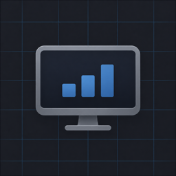
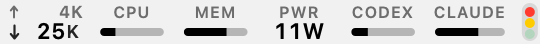
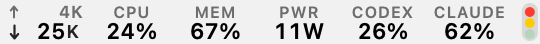
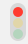
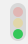
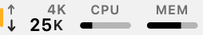
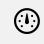
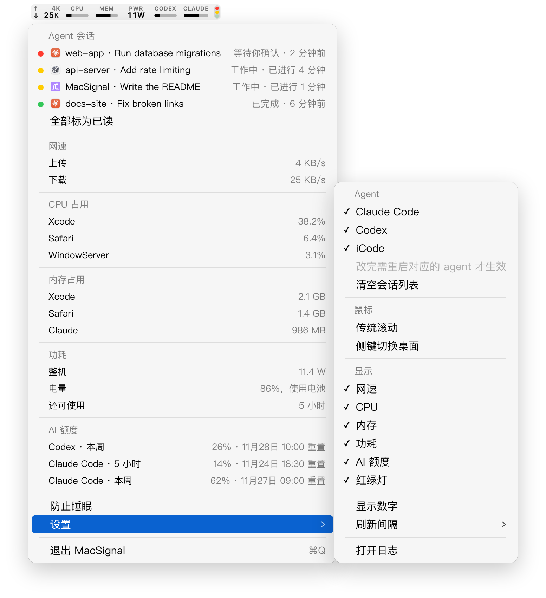

<div align="center">



# MacSignal

**在菜单栏一眼看清你的 Mac 和你的 coding agent。**

网速、CPU、内存、功耗；Claude Code、Codex、iCode 哪个会话在等你；AI 订阅额度还剩多少。

  

[English](README.md) | 简体中文

</div>

## 为什么用 MacSignal

- **agent 需要你时马上知道。** 菜单栏里的三色红绿灯：有会话在等你批准，红灯立刻亮，不用再挨个翻终端标签页。
- **额度用完前就看得到。** Claude Code 和 Codex 的用量就在 CPU、内存旁边，重置时间点开就有。
- **小巧的系统监视器。** 网速、CPU、内存、功耗挤在一个紧凑的菜单栏项里，跟随浅色 / 深色菜单栏。悬停看详情，点开看占用最高的进程。
- **轻量、本地。** Swift + AppKit 原生编写，没有第三方依赖、程序坞图标和后台服务，不需要管理员权限。除了[下文](#ai-额度)说明的 Claude Code 用量请求，没有任何数据离开你的 Mac。
- **中英文界面**，跟随系统语言。

## 支持的 agent

| Agent | 会话状态 | 订阅额度 |
| --- | :---: | :---: |
| [Claude Code](https://www.anthropic.com/claude-code) | ✓ | ✓ |
| [Codex](https://openai.com/codex) | ✓ | ✓ |
| [iCode](https://github.com/openJiuwen-ai/iCode) | ✓ | — |

MacSignal 通过各个 agent 自己的 hook 接入：不套壳，不改 agent 的程序。见[接入 agent](#接入-agent)。

> **还不了解 iCode？** [iCode](https://github.com/openJiuwen-ai/iCode) 是一个开源的终端 coding agent。agent 是配置而不是代码；不同服务商的模型配置并排放着，对话中途随时切换；agent 改过的每个文件都能按轮次看 diff、回滚；轨迹视图告诉你时间和 token 花在了哪里。用 `uv tool install iCode-TUI` 安装，然后运行 `icode` 试试。

## 菜单栏显示什么

在「设置 › 显示」里选模块。下面的图跟随你的 GitHub 主题；MacSignal 本身跟随菜单栏。

**进度条或数字。** CPU、内存和 AI 额度默认是进度条，打开「显示数字」后显示百分比。

<table>
  <tr><th>进度条（默认）</th></tr>
  <tr><td><picture><source media="(prefers-color-scheme: dark)" srcset="docs/menu-bar-dark.png"></picture></td></tr>
  <tr><th>显示数字</th></tr>
  <tr><td><picture><source media="(prefers-color-scheme: dark)" srcset="docs/numbers-dark.png"></picture></td></tr>
</table>

**红绿灯。** 每盏灯统计所有已接入 agent 的会话，几盏灯可以同时亮。

<table>
  <tr>
    <td align="center"><picture><source media="(prefers-color-scheme: dark)" srcset="docs/light-waiting-dark.png"></picture></td>
    <td align="center"><picture><source media="(prefers-color-scheme: dark)" srcset="docs/light-working-dark.png"></picture></td>
    <td align="center"><picture><source media="(prefers-color-scheme: dark)" srcset="docs/light-done-dark.png"></picture></td>
    <td align="center"><picture><source media="(prefers-color-scheme: dark)" srcset="docs/light-idle-dark.png"></picture></td>
  </tr>
  <tr>
    <td align="center"><b>红</b><br>等你确认</td>
    <td align="center"><b>黄</b><br>工作中</td>
    <td align="center"><b>绿</b><br>已完成，你还没看</td>
    <td align="center"><b>全灭</b><br>没有需要你的</td>
  </tr>
</table>

**防止睡眠** 打开时最左边有一道橙色竖条，一眼就知道 Mac 不会睡眠。所有模块都关掉时，菜单栏显示 app 图标。

<table>
  <tr><th>防止睡眠已打开</th><th>没有模块</th></tr>
  <tr>
    <td><picture><source media="(prefers-color-scheme: dark)" srcset="docs/sleep-dark.png"></picture></td>
    <td align="center"><picture><source media="(prefers-color-scheme: dark)" srcset="docs/icon-only-dark.png"></picture></td>
  </tr>
</table>

## 点开菜单

点一下菜单栏项就能看到详情：agent 会话、CPU 和内存占用最高的进程、功耗、AI 额度和重置时间，以及设置。图中是示例数据。

<p align="center"><picture><source media="(prefers-color-scheme: dark)" srcset="docs/menu-zh-dark.png"></picture></p>

## 安装

需要 Xcode 或 Command Line Tools（Swift 5.9 及以上）。

```sh
git clone https://github.com/Miaoranmmm/MacSignal.git && cd MacSignal
./scripts/install.sh
```

`install.sh` 会构建 app、退出正在运行的 MacSignal、安装到 `/Applications/MacSignal.app` 并启动。要开机启动，在「系统设置 › 通用 › 登录项」里添加。

<details>
<summary><b>签名</b>：重新构建后保留辅助功能权限</summary>

macOS 按 app 的签名记住辅助功能权限。默认的临时签名（ad hoc）下，每次重新构建都像一个新 app，需要重新授权。改用钥匙串里的证书签名即可：Apple Development 证书，或者自签名的代码签名证书。钥匙串里有名为 `MacSignal Local Signing` 的证书时 `install.sh` 会自动使用，也可以指定：

```sh
MACSIGNAL_SIGN_IDENTITY="Apple Development: Your Name (TEAMID)" ./scripts/install.sh
```

只构建不安装：`./scripts/build.sh`（输出在 `build/MacSignal.app`）。日常不要从 `build/` 运行：agent 的 hook 会记住 app 启动时的路径，而 `build/` 每次构建都会被替换。

</details>

## 接入 agent

1. 在「设置 › Agent」里勾选 Claude Code、Codex 或 iCode。本机没装的 agent 是灰的。
2. 重启对应的 agent。
3. **仅 Codex：** Codex 只运行你批准过的 hook。打开 Codex，在它提示时批准 MacSignal 的 hook。批准前不会显示 Codex 的会话，也读不到 Codex 的额度。hook 命令变化后（例如移动了`MacSignal.app`），Codex 会要求重新批准。

MacSignal 修改这些文件来添加 hook：

| Agent | 修改的文件 |
| --- | --- |
| Claude Code | `~/.claude/settings.json` |
| Codex | `~/.codex/hooks.json`，以及 `~/.codex/config.toml` 里的 `[features] hooks = true` |
| iCode | `~/.chrys/hooks/hooks.yaml` |

第一次修改前，原文件备份为 `<文件名>.bak-macsignal`。取消勾选只移除 MacSignal 自己加的 hook，并立即清掉该 agent 的会话。配置无法读取或 hook 写法无法识别时，MacSignal 会提示错误并保留原文件。Codex 用其他写法定义 `features` 时，请在 `config.toml` 的 `[features]` 表中设置 `hooks = true`，再接入 MacSignal 的 hook。

每个 hook 运行 `MacSignal hook <状态> <agent>`，通过 `~/.macsignal.sock` 把会话状态发给正在运行的 MacSignal。MacSignal 没在运行时 hook 什么也不做，agent 不会报错。

### 会话列表

点开菜单栏项就能看到会话。每行前面是 agent 的图标。需要关注的会话（等你确认、工作中、完成未读）总是列出；已读的只在总行数不到 5 行时补上，安静超过 30 分钟的放进「更早的 N 个会话」。点一行打开那个会话（在 Claude 或 Codex 应用里，或它所在的应用）并标为已读，或者用「全部标为已读」。

## AI 额度

在「设置 › 显示」里勾选「AI 额度」，接入 Claude Code 或 Codex 后才会出现。只有订阅账号才有额度（例如 Claude Pro / Max，或带 Codex 的 ChatGPT 套餐）。菜单栏这一格显示用得最多的那个窗口，菜单里列出每个窗口和它的重置时间。所有窗口都过了重置时间后显示「—」，等下一次使用。

- **Codex**：每轮结束时，从 Codex 自己的会话日志里读，所以需要先批准 hook（见[接入 agent](#接入-agent)）。
- **Claude Code**：每 5 分钟从 Claude Code 的 `/usage` 命令所用的同一个服务读取。MacSignal 和 Claude Code 一样，用 `security` 命令从钥匙串的「Claude Code-credentials」读取登录信息，不会弹出钥匙串对话框；接入 Claude Code 并勾选「AI 额度」即表示允许。登录信息只发给 Anthropic 的用量服务，不写进日志，也不会被改动。
  - 只用 Claude 桌面端时，这份登录几小时后会过期。这时 MacSignal 让 Claude Code 自己续上：先运行 `claude mcp list`（不消耗额度），不行再发一个极小的请求给最小的模型（约 650 token，最多每 8 小时一次）。两者都带上系统设置里的代理。
  - MacSignal 还会在 `~/.claude/settings.json` 里加一条不输出任何内容的 `statusLine` 命令，让你在终端里使用时额度随之更新。你已经有自己的状态栏时，MacSignal 会保留它，并继续每 5 分钟读取额度。

## 设置

所有设置都在菜单的「设置」里（见[点开菜单](#点开菜单)）。选择都会被记住，只有「防止睡眠」在 MacSignal 重启后恢复为关闭。

| 设置 | 作用 | 默认 |
| --- | --- | --- |
| **防止睡眠**（主菜单） | 阻止系统空闲睡眠，电池和电源下都有效；显示器仍可以关闭。 | 关 |
| **Agent** › Claude Code / Codex / iCode | 在对应 agent 里添加或移除 MacSignal 的 hook（[详情](#接入-agent)），之后重启 agent。 | 关 |
| **Agent** › 清空会话列表 | 清空会话列表，列表里有会话时才出现。 | — |
| **鼠标** › 传统滚动 | 只反转鼠标滚轮的方向，触控板保持自然滚动。 | 关 |
| **鼠标** › 侧键切换桌面 | 鼠标的后退 / 前进键切换到左边 / 右边的桌面。 | 关 |
| **显示** › 网速 | 上传和下载速度。 | 开 |
| **显示** › CPU | 总体 CPU 使用率。 | 开 |
| **显示** › 内存 | 已用内存。 | 开 |
| **显示** › 功耗 | 整机功耗。只在能读到功耗的 Mac（如笔记本）上出现。 | 关 |
| **显示** › AI 额度 | Claude Code 和 Codex 的额度（[详情](#ai-额度)），接入其中一个后出现。 | 关 |
| **显示** › 红绿灯 | agent 会话状态灯，接入 agent 后出现。 | 开 |
| **显示** › 显示数字 | CPU、内存和 AI 额度显示百分比而不是进度条。 | 关 |
| **显示** › 刷新间隔 | 读数多久更新一次：0.5、1、2、3、5 或 10 秒。 | 1 秒 |
| **打开日志** | 打开 `~/Library/Logs/MacSignal.log`，接入 agent 后出现。 | — |

两个鼠标选项都需要辅助功能权限。授权前选项显示「–」和「打开辅助功能设置…」，MacSignal 每 2 秒重新检查一次。如果 MacSignal 已在列表里打开了却仍在等待，列表里的多半是旧版本：移除后重新添加（或者给 app [签名](#安装)，就不会再遇到）。

菜单其余部分按菜单栏的顺序排列，每个显示中的模块一段：「Agent 会话」「网速」「CPU 占用」「内存占用」「功耗」（电量、充电状态、剩余时间）和「AI 额度」（每个窗口的已用比例和重置时间）。

<details>
<summary><b>读数怎么算</b></summary>

- **CPU**：两次 Mach CPU tick 计数之差算出的总体使用率。macOS 成批更新这些计数，所以 0.5 秒间隔时 CPU 大约每秒变一次。
- **进程排名**：每个进程在采样间隔内用掉的 CPU 时间，除以活动逻辑 CPU 数（100% 是整台机器）；内存用物理占用（physical footprint）。每个 PID 配合启动时间，避免把复用的 PID 当成同一进程。
- **内存**：App 内存 + 联动内存 + 压缩内存。App 内存是活跃、非活跃和推测页，减去文件缓存页和可清除页。其他监视工具的定义可能不同。
- **网速**：所有已启用的物理 `enN` 接口之和（Wi-Fi、以太网、USB 和雷雳网卡），含局域网流量，使用 64 位 `NET_RT_IFLIST2` 计数。不含回环、VPN 隧道和网桥，避免重复计算；VPN 流量仍计入物理接口。
- **单位**：B/s、KB/s、MB/s、GB/s……按 1000 进位，数字最多三位。

采样在单独的队列上运行，睡眠时停止；唤醒后约半秒给出第一批读数。

</details>

## 开发

```sh
./scripts/test.sh
build/MacSignal.app/Contents/MacOS/MacSignal --diagnose
build/MacSignal.app/Contents/MacOS/MacSignal --render-preview build/preview.png \
  --modules network,cpu,memory,power,quota,light --agents 1,2,0 --quota codex=26,claude=62
```

`--diagnose` 采样一秒，打印读数后退出。`--render-preview` 用和菜单栏相同的绘制代码生成 2x PNG（本文的图都由它生成）：`--modules` 选择模块，`--agents 等待,工作中,完成未读` 点亮红绿灯，`--quota agent=百分比` 给出额度，`--numbers` 显示百分比，`--light` 按浅色菜单栏绘制，`--sleep`画出防止睡眠的竖条。

app 图标在构建时由 `Design/AppIcon/monitor-grid-fullbleed-v3.png` 生成。
